# Đánh giá ảnh hưởng của cơ chế điều chuẩn phân kỳ Kullback–Leibler đến hiệu quả học chính sách trong học tăng cường đa tác tử hợp tác

**Nghiên cứu đối chứng MAIC và Exact KL trên ba môi trường 16 × 16**

Repository này tập trung vào tác động của cơ chế điều chuẩn chính sách bằng Kullback–Leibler divergence (KL) trong học tăng cường đa tác tử hợp tác (*cooperative multi-agent reinforcement learning*, MARL). Đối tượng nghiên cứu chính là **MAIC**, phương pháp kết hợp *counterfactual advantage*, entropy regularization và *information gain* (IG) nhằm hỗ trợ khám phá trong môi trường nhiều tác tử.

Thực nghiệm chính xem xét sự khác nhau giữa **KL surrogate trong MAIC gốc** và **phân kỳ KL rời rạc được tính trực tiếp và lấy gradient trong hàm mất mát Actor**. Kiến trúc MAIC và bộ ước lượng information gain được giữ nguyên. Exact KL là một công thức đã biết; đóng góp của nghiên cứu nằm ở phân tích có đối chứng tác động của cách đưa KL vào tối ưu, không phải phát minh một thuật toán IG mới.

Mã nguồn gốc: [Hoàng Văn Phi – MAIC](https://github.com/hoangvanphi2004/MAIC), commit cố định `ded6164f99742db4769a7f05b45f6e6007ff8b1a`.

**Trạng thái dữ liệu:** hoàn thành 90 run huấn luyện và 180 bản ghi đánh giá checkpoint cuối. Kết quả được trình bày bằng trung bình và độ lệch chuẩn qua **5 seed huấn luyện**, không coi các episode đánh giá là những seed độc lập.

## 1. Câu hỏi nghiên cứu

- **RQ1 — Hiệu quả học chính sách:** tính toán trực tiếp phân kỳ KL có thay đổi reward và tỷ lệ hoàn thành nhiệm vụ của MAIC so với KL surrogate không?
- **RQ2 — Tác động của information gain:** hiệu ứng của Exact KL có giống nhau ở MAIC và MASAC (không dùng IG) hay không?
- **RQ3 — Tính ổn định và giới hạn:** kết quả có nhất quán giữa các seed, checkpoint và chế độ chọn hành động greedy/stochastic không? Đa dạng trạng thái có gắn với thành công của nhiệm vụ hợp tác không?

## 2. Thiết kế thực nghiệm chính

| Thành phần | Thiết lập |
|:--|:--|
| Môi trường | `MultiGrid-MultiTargetEmpty-16x16-v0` (MTE16); `MultiGrid-PushBox-16x16-v0` (PushBox16); `MultiGrid-PassSparse-16x16-v0` (PassSparse16) |
| Số tác tử | 2 |
| Kích thước lưới | 16 × 16 |
| Horizon | 40 bước/episode |
| Thuật toán/cấu hình | MAIC, MAIC + Exact KL, MASAC, MASAC + Exact KL, MADDPG, COMA_Phi |
| Seed huấn luyện | 42, 43, 44, 45, 46 |
| Ngân sách huấn luyện | 10.000 episode/run, tổng cộng 900.000 episode |
| Số lần huấn luyện | 3 môi trường × 6 cấu hình × 5 seed = **90 run** |
| Checkpoint | Mỗi 500 episode và checkpoint cuối |
| Chế độ đánh giá | Greedy và Stochastic |
| Episode đánh giá | 100 episode/seed/chế độ; `eval_seed = 20260` |
| Tổng bản ghi đánh giá cuối | **180 JSON = 90 checkpoint cuối × 2 chế độ** |
| Trạng thái quan sát | `obs_state_mode = simple` |

### 2.1. Siêu tham số chung của MAIC và các biến thể

Các tham số dưới đây được lấy từ `train_config.json` của **commit MAIC gốc được cố định trong Study16** và các giá trị ghi đè trong `study16_pipeline.py`. Đây là thiết lập của bộ thí nghiệm mới, không được trộn với siêu tham số trong các lần chạy trước hoặc thông số mô tả của luận văn.

| Tham số | Giá trị | Tham số | Giá trị |
|:--|--:|:--|--:|
| Replay buffer (`replay_size`) | 100.000 | Batch size | 1.024 |
| Số bước khám phá ban đầu (`start_steps`) | 100 | Learning rate | 0,0003 |
| Discount factor `γ` | 0,99 | Target network `τ` | 0,02 |
| Kích thước hidden layer | 128 | `alpha1` (khởi tạo) | 0,02 |
| `alpha2` (khởi tạo) | 0,02 | `alpha_kl` | 1,0 |
| Số lần cập nhật Actor (`policy_update_steps`) | 3 | Tự động điều chỉnh entropy | Có |
| Target entropy scale | 0,2 | `metrics_save_every` | 10 |
| `steps_per_update` | 1 | `updates_num` | 1 |

**Phạm vi áp dụng:** những tham số MAIC ở trên không mặc nhiên là thiết lập nội bộ của baseline MADDPG. Mỗi run lưu `config.json`, `run_meta.json` và dữ liệu kiểm chứng độc lập trong thư mục `runs_study16/` trên VAST.

### 2.2. Cấu hình đối chứng

| Cấu hình | Hệ số IG | Hệ số entropy | Cơ chế KL trong Actor |
|:--|--:|--:|:--|
| MAIC | 1 | 1 | KL surrogate theo mã MAIC gốc |
| MAIC + Exact KL | 1 | 1 | Exact KL rời rạc, lấy gradient trực tiếp |
| MASAC | 0 | 1 | KL surrogate theo mã MAIC gốc |
| MASAC + Exact KL | 0 | 1 | Exact KL rời rạc, lấy gradient trực tiếp |
| COMA_Phi | 0 | 0 | Cấu hình MAIC gốc (không phải COMA on-policy đầy đủ) |
| MADDPG | — | — | Baseline MADDPG triển khai riêng |

`COMA_Phi` chỉ là tên cấu hình thí nghiệm từ mã MAIC khi tắt IG và entropy, **không đồng nhất với COMA on-policy nguyên bản**. Tất cả các cấu hình MAIC và Exact KL sử dụng cùng định nghĩa môi trường, được kiểm tra bằng cách đối chiếu các tệp môi trường trong script chuẩn bị.

## 3. Cơ sở toán học và thay đổi trong hàm mục tiêu Actor

Nghiên cứu xem xét cách thức thành phần điều chuẩn Kullback–Leibler (KL) tham gia vào cập nhật chính sách trong MAIC. Kiến trúc Actor–Critic, counterfactual advantage và cơ chế ước lượng information gain được giữ nguyên giữa hai cấu hình MAIC so sánh.

### 3.1. Chính sách đa tác tử

Với $n$ tác tử có chính sách phân tán, phân phối hành động chung được phân tích thành

$$
\pi_{\theta}(\mathbf{a}\mid\mathbf{o})
=\prod_{i=1}^{n}\pi_{\theta_i}(a_i\mid o_i).
$$

### 3.2. Thành phần KL theo hàm thay thế trong MAIC gốc

Đặt $\ell_{\theta}=\sum_{j=1}^{n}\log\pi_{\theta_j}(a_j\mid o_j)$ và $\ell_{\mathrm{old}}$ là tổng log-xác suất dưới chính sách tham chiếu. Hệ số cập nhật trong mã MAIC gốc bao gồm thành phần KL theo hàm thay thế:

$$
\begin{aligned}
g_i^{\mathrm{sur}}={}&(\alpha_1c_H+\lambda)(\ell_{\theta}+1)\\
&-\lambda\ell_{\mathrm{old}}-\widehat A_i-\alpha_2c_I\widehat I.
\end{aligned}
$$

Hàm mất mát Actor sử dụng hệ số đã dừng gradient:

$$
\mathcal L_{\mathrm{sur}}
=\sum_{i=1}^{n}\mathbb E_{\mathcal B}
\left[\mathrm{sg}(g_i^{\mathrm{sur}})\log\pi_{\theta_i}(a_i\mid o_i)\right].
$$

Trong đó, $\mathrm{sg}$ là toán tử dừng gradient, $\widehat A_i$ là counterfactual advantage, $\widehat I$ là information gain ước lượng, $\alpha_1$ và $\alpha_2$ là hệ số entropy và information gain, còn $c_H,c_I$ là các hệ số điều khiển tương ứng. Ký hiệu $\lambda$ biểu diễn hệ số KL. Phép tính KL trên toàn phân phối hành động có thể xuất hiện trong quá trình ghi log của mã gốc, nhưng thành phần cập nhật Actor sử dụng biểu thức surrogate ở trên.

### 3.3. Điều chuẩn KL trực tiếp trên phân phối hành động rời rạc

Ở quan sát $o_i$, phân kỳ KL của toàn bộ phân phối hành động có dạng

$$
D_i(o_i;\theta_i)
=\sum_{a_i\in\mathcal A_i}
\pi_{\theta_i}(a_i\mid o_i)
\log\frac{\pi_{\theta_i}(a_i\mid o_i)}{\pi_{\mathrm{old},i}(a_i\mid o_i)}.
$$

Hệ số cơ sở sau khi loại bỏ thành phần KL theo hàm thay thế là

$$
g_i^{\mathrm{base}}=\alpha_1c_H(\ell_{\theta}+1)
-\widehat A_i-\alpha_2c_I\widehat I.
$$

Hàm mất mát Actor của biến thể Exact KL được phân tách thành

$$
\mathcal L_{\mathrm{Actor}}^{\mathrm{ExactKL}}
=\mathcal L_{\mathrm{base}}+\lambda\mathcal L_{\mathrm{KL}},
$$

$$
\mathcal L_{\mathrm{base}}=\sum_{i=1}^{n}\mathbb E_{\mathcal B}
\left[\mathrm{sg}(g_i^{\mathrm{base}})\log\pi_{\theta_i}(a_i\mid o_i)\right],
$$

$$
\mathcal L_{\mathrm{KL}}=\sum_{i=1}^{n}\mathbb E_{\mathcal B}
\left[D_i(o_i;\theta_i)\right].
$$

Trong hạng KL cuối, gradient lan truyền trực tiếp theo chính sách hiện tại, còn chính sách tham chiếu được cố định. Thay đổi này **không thay thế bộ ước lượng information gain** hoặc cấu trúc MAIC. Vì các quan sát được lấy từ replay buffer ngoài chính sách, biểu thức trên không mặc nhiên bảo đảm cải thiện đơn điệu hay ràng buộc trust region theo nghĩa lý thuyết.

Mô tả chi tiết về thiết kế đối chứng và công thức được lưu tại [tài liệu phương pháp](docs/study16/METHOD.md).

## 4. Kết quả thực nghiệm chính

Bảng dưới trình bày **tỷ lệ hoàn thành nhiệm vụ (%) tại checkpoint cuối**, là trung bình qua 5 seed huấn luyện. Dấu `±` biểu diễn độ lệch chuẩn giữa 5 seed (*population SD*).

| Thuật toán | MTE16 Greedy | MTE16 Stochastic | PushBox16 Stochastic | PassSparse16 Stochastic |
|:--|--:|--:|--:|--:|
| MAIC | 9,8 ± 6,2 | 41,4 ± 32,9 | 0 ± 0 | 0 ± 0 |
| **MAIC + Exact KL** | **25,6 ± 21,5** | 37,8 ± 29,0 | **60,0 ± 49,0** | 0 ± 0 |
| MASAC | 7,2 ± 6,6 | 17,4 ± 16,0 | 0 ± 0 | 0 ± 0 |
| **MASAC + Exact KL** | **37,2 ± 35,6** | **44,2 ± 41,2** | 0 ± 0 | 0 ± 0 |
| MADDPG | 4,6 ± 9,2 | 13,4 ± 25,8 | **60,0 ± 49,0** | 0 ± 0 |
| COMA_Phi | 0 ± 0 | 0 ± 0 | 0 ± 0 | 0 ± 0 |

[Toàn bộ bảng kết quả 18 cấu hình](docs/study16/KET_QUA_TV.md) · [CSV của 90 run](results/study16/per_seed_values.csv) · [Bảng trung bình và SD](results/study16/summary.csv)

### 4.1. Multi-Target (MTE16) và sự phụ thuộc vào chế độ đánh giá

MAIC + Exact KL có tỷ lệ thành công **greedy tăng từ 9,8% lên 25,6%**, tương ứng chênh lệch **+15,8 điểm phần trăm**. Trái lại, ở chế độ **stochastic**, tỷ lệ thành công giảm từ 41,4% xuống 37,8% (−3,6 điểm phần trăm). Do đó, không thể kết luận Exact KL luôn nâng cao hiệu quả MAIC trên MTE16.

Đối với MASAC, Exact KL đi kèm mức tăng trung bình từ **7,2% lên 37,2%** (greedy) và từ **17,4% lên 44,2%** (stochastic). Tuy nhiên, mức phân tán giữa các seed khá lớn, cần tránh kết luận về ưu thế có ý nghĩa thống kê chỉ dựa trên trung bình.

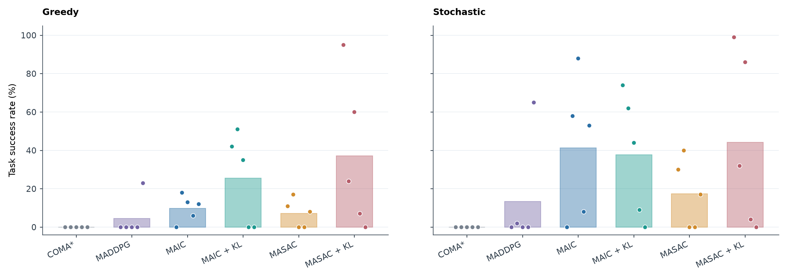

*Hình 1. Tỷ lệ hoàn thành nhiệm vụ tại checkpoint cuối trên MTE16. Cột biểu diễn trung bình qua năm seed, các điểm thể hiện giá trị của từng seed. Màu được gán theo thuật toán, không theo seed.*

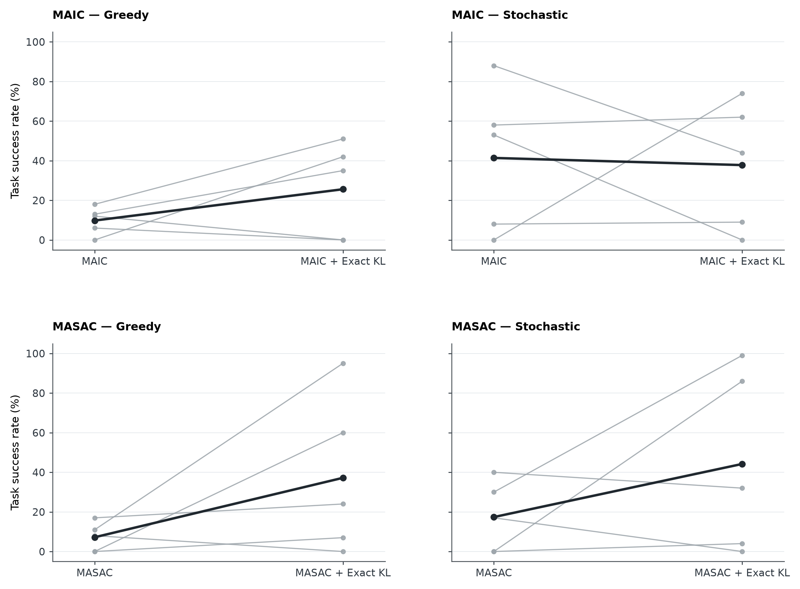

*Hình 2. So sánh theo cặp giữa cấu hình gốc và Exact KL trên cùng seed huấn luyện. Các đường mảnh thể hiện từng seed và đường đậm thể hiện trung bình.*

### 4.2. PushBox16 và sự khác biệt giữa các cấu hình MAIC

MAIC gốc có tỷ lệ hoàn thành nhiệm vụ bằng **0% tại cả 5 seed**, trong khi MAIC + Exact KL có **3/5 seed thành công hoàn toàn** (seed 44, 45 và 46) và 2/5 seed thất bại (seed 42 và 43). Giá trị trung bình của năm seed là **60%**, không có nghĩa một chính sách đơn lẻ thành công 60%. MADDPG cũng đạt 60% nhưng các seed thành công không trùng hoàn toàn với MAIC + Exact KL.

Reward trung bình trên 10% episode cuối: **MAIC = 0**, **MAIC + Exact KL = 59,980 ± 48,973**, **MADDPG = 59,720 ± 48,763**. Đây là bằng chứng mô tả về sự khác biệt đáng quan tâm nhưng chưa đủ để khẳng định ưu thế có ý nghĩa thống kê. Kiểm định đổi dấu chính xác hai phía theo cặp cho MAIC so với MAIC + Exact KL cho `p = 0,25`.

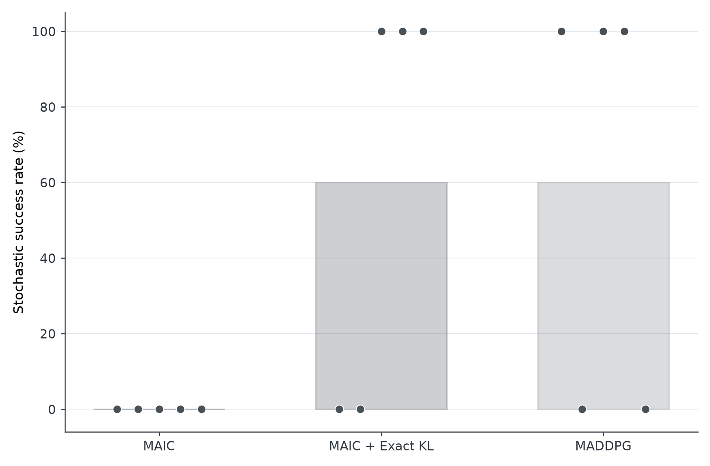

*Hình 3. Tỷ lệ hoàn thành nhiệm vụ stochastic tại checkpoint cuối trên PushBox16. Mỗi điểm là một seed; các cột thể hiện trung bình.*

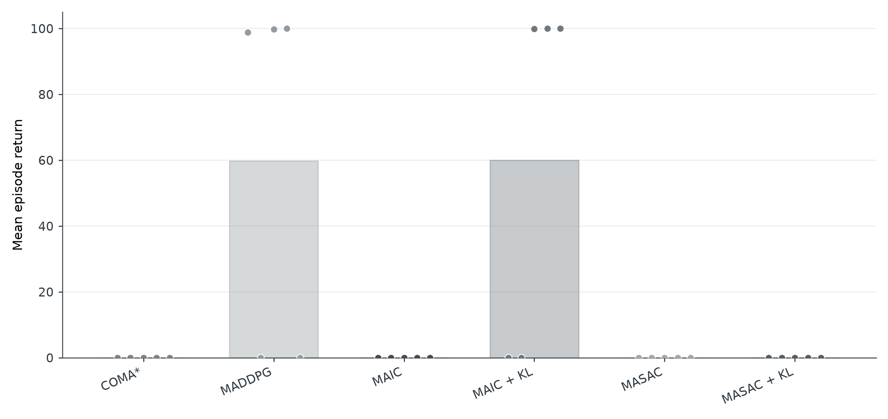

*Hình 4. Phần thưởng trung bình của 10% episode huấn luyện cuối theo từng thuật toán và seed.*

### 4.3. PassSparse16 và giới hạn của khám phá trạng thái

Tất cả sáu cấu hình có tỷ lệ hoàn thành nhiệm vụ bằng **0%** tại checkpoint cuối (cả greedy và stochastic). Tuy nhiên, MAIC + Exact KL ghi nhận **20.669 ± 18.516** trạng thái duy nhất vào cuối huấn luyện, so với **582 ± 106** của MAIC gốc. MADDPG ghi nhận **34.506 ± 1.978**, nhưng cũng không hoàn thành nhiệm vụ.

Nhận xét quan trọng: **nhiều trạng thái được ghi nhận không tương đương với phối hợp thành công**. Chỉ số `unique_states_final` phụ thuộc cách mã hóa và ghi log; cần kiểm chứng cách đếm trước khi sử dụng như một phép đo định lượng độ bao phủ của không gian trạng thái.

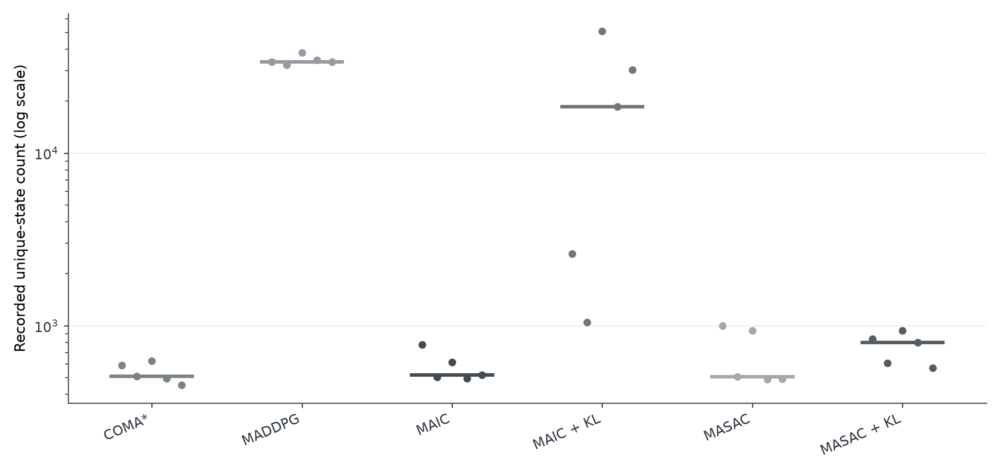

*Hình 5. Số trạng thái duy nhất được ghi nhận tại cuối huấn luyện trên PassSparse16. Trục tung sử dụng thang logarit; các điểm biểu diễn từng seed và đoạn ngang là trung vị.*

### 4.4. Diễn biến huấn luyện và độ ổn định checkpoint

Các đường học theo episode và hình đánh giá checkpoint chỉ sử dụng **JSON huấn luyện/đánh giá thực** trong `runs_study16`; các checkpoint thiếu đánh giá không được nội suy. Tất cả các hình cuối cùng (PNG/PDF) và hình phân tích theo checkpoint có trong [thư mục hình Study16](assets/study16/figures/).

<!-- STUDY16_TRAINING_FIGURES_START -->
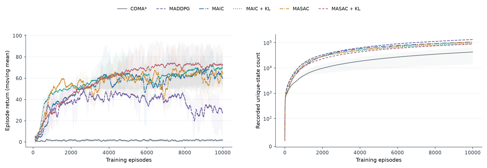

*MTE16: quá trình học trên môi trường nhiều mục tiêu. Đường thể hiện trung bình qua năm seed, vùng tô trải từ phân vị 25% đến 75%.*

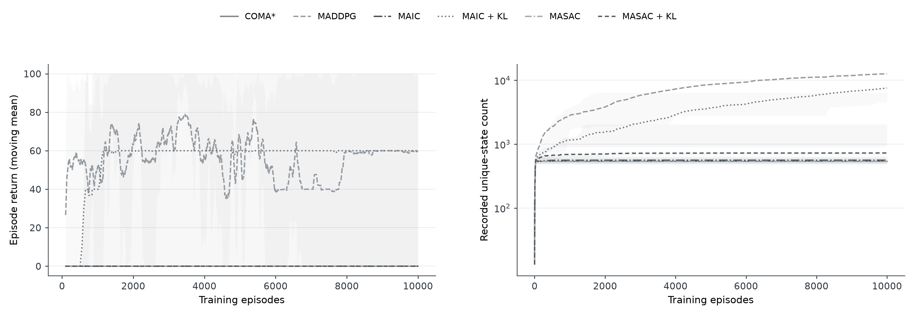

*PushBox16: quá trình học trên nhiệm vụ phối hợp đẩy hộp. Đường thể hiện trung bình qua năm seed, vùng tô trải từ phân vị 25% đến 75%.*

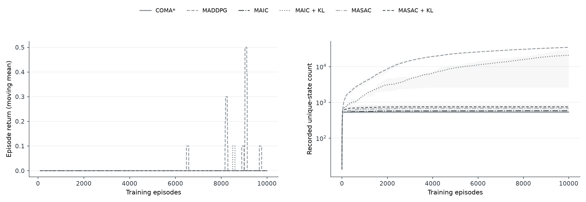

*PassSparse16: reward và số trạng thái được ghi nhận. Đường thể hiện trung bình qua năm seed, vùng tô trải từ phân vị 25% đến 75%.*

<!-- STUDY16_TRAINING_FIGURES_END -->

**Lưu ý thống kê:** số lượng seed còn nhỏ (n = 5). Các chênh lệch trung bình, đường học và ví dụ rollout là kết quả mô tả; chúng không chứng minh tính ưu việt tổng quát, cơ chế nhân quả hay khả năng khái quát trên môi trường chưa kiểm tra.


Phân tích sai khác theo seed, độ phân tán và các giả thuyết cần kiểm chứng được trình bày tại [phân tích chi tiết Study16](docs/study16/PHAN_TICH_THEO_SEED.md).

## 5. Video mô phỏng từ checkpoint đã huấn luyện

Các GIF dưới đây chạy trực tiếp trong README GitHub. Mỗi video là **một episode đã ghi**, không đại diện cho tỷ lệ thành công trung bình trên 100 episode đánh giá. File MP4 và JSON metadata đi kèm cho phép truy xuất thuật toán, seed huấn luyện, seed đánh giá và kết quả.

### 5.1. MTE16 — MAIC, stochastic, thành công

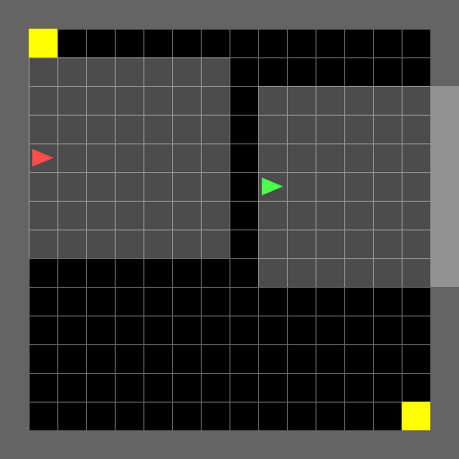

[Video MP4](assets/study16/demos/MTE16_MAIC_trainseed44_stochastic_evalseed20261_SUCCESS.mp4) · [Metadata JSON](assets/study16/demos/MTE16_MAIC_trainseed44_stochastic_evalseed20261_SUCCESS.json) — train seed 44, eval seed 20261.

### 5.2. MTE16 — MASAC + Exact KL, stochastic, thành công

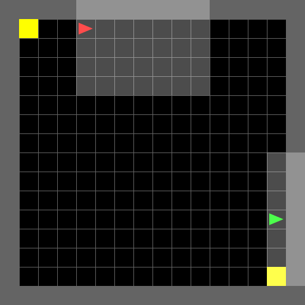

[Video MP4](assets/study16/demos/MTE16_MASAC_ExactKL_trainseed42_stochastic_evalseed20261_SUCCESS.mp4) · [Metadata JSON](assets/study16/demos/MTE16_MASAC_ExactKL_trainseed42_stochastic_evalseed20261_SUCCESS.json) — train seed 42, eval seed 20261.

### 5.3. PushBox16 — MAIC + Exact KL, greedy, thành công

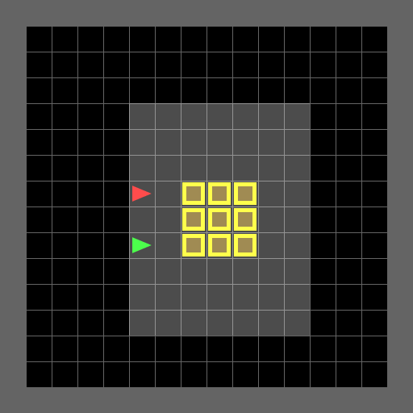

[Video MP4](assets/study16/demos/PushBox16_MAIC_ExactKL_trainseed46_greedy_evalseed20261_SUCCESS.mp4) · [Metadata JSON](assets/study16/demos/PushBox16_MAIC_ExactKL_trainseed46_greedy_evalseed20261_SUCCESS.json) — train seed 46, eval seed 20261.

### 5.4. PushBox16 — MADDPG, greedy, thành công


[Video MP4](assets/study16/demos/PushBox16_MADDPG_trainseed45_greedy_evalseed20261_SUCCESS.mp4) · [Metadata JSON](assets/study16/demos/PushBox16_MADDPG_trainseed45_greedy_evalseed20261_SUCCESS.json) — train seed 45, eval seed 20261.

### 5.5. PassSparse16 — MAIC + Exact KL, greedy, thất bại

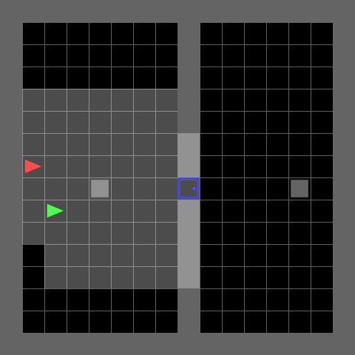

[Video MP4](assets/study16/demos/PassSparse16_MAIC_ExactKL_trainseed42_greedy_evalseed20261_FAILURE.mp4) · [Metadata JSON](assets/study16/demos/PassSparse16_MAIC_ExactKL_trainseed42_greedy_evalseed20261_FAILURE.json) — train seed 42, eval seed 20261; **không hoàn thành nhiệm vụ**.

Các video trên được tạo từ chính sách đã học, không sử dụng bộ điều khiển được lập trình sẵn để minh họa thành công của tác tử. File `source_maic/refactor/inference.mp4` không được coi là một video kiểm nghiệm của Study16.

## 6. Mã nguồn và tái lập

```text
study16_pipeline.py                Bộ điều phối 90 run / đánh giá / tổng hợp
source_maic/                       Mã MAIC gốc, clone từ commit cố định trên VAST
third_party/MAIC/                  Mã nghiên cứu kế thừa lưu trong repository
variants/exactkl/                  Thay đổi KL trong Actor loss
baselines/                         Baseline MADDPG
runs_study16/                     Dữ liệu run và checkpoint gốc trên VAST (không commit Git)
results/study16/                   CSV kết quả 90 run và thống kê tổng hợp
assets/study16/figures/            Hình PNG và PDF dùng trong bài báo
assets/study16/demos/              5 video MP4, GIF và metadata
scripts/study16/                  Script tái tạo đồ thị
reports/ và reports_stage_b/       Thực nghiệm lịch sử
```

Tái lập trên môi trường đã cài đặt phụ thuộc và có mã MAIC gốc đúng commit:

```bash
python3 study16_pipeline.py prepare
python3 study16_pipeline.py status
python3 study16_pipeline.py train --jobs 2
python3 study16_pipeline.py eval --jobs 2
python3 study16_pipeline.py summarize
```

**Không dùng `train --retry-failed` để tiếp tục một run dở nếu cần khôi phục chính xác**: checkpoint `.pth` hiện không chứa đầy đủ replay buffer và optimizer state. Hướng dẫn cụ thể: [Thiết lập Study16](SETUP_STUDY16.md) · [Khả năng tái lập](docs/study16/REPRODUCIBILITY.md).

## 7. Dữ liệu, checkpoint và trạng thái công bố

Repository lưu bảng kết quả của 90 run, biểu đồ và năm bộ GIF/MP4/JSON từ checkpoint cuối. Toàn bộ checkpoint cuối/trung gian và raw log nằm ngoài lịch sử Git thông thường vì dung lượng lớn. **Không khẳng định checkpoint đã có trên GitHub Release khi chưa có Release được xác nhận.** Để lưu trữ toàn bộ, cần tạo archive có SHA-256, tải lên GitHub Release hoặc kho lưu trữ ngoài rồi bổ sung đường dẫn kiểm chứng tại đây.

Các kết luận giới hạn trong ba môi trường 16 × 16, seed 42–46, 10.000 episode và các cấu hình đã triển khai. Kết quả chưa chứng minh tính ổn định tổng quát hoặc vượt trội có ý nghĩa thống kê của Exact KL.

## 8. Tài liệu liên quan

- [Danh mục dữ liệu và checkpoint](docs/study16/LUU_TRU_DU_LIEU.md)
- [Phân tích chi tiết kết quả theo seed](docs/study16/PHAN_TICH_THEO_SEED.md)
- [Thư viện hình và video mô phỏng](docs/study16/FIGURES_AND_DEMOS.md)

- [Kết quả chi tiết tiếng Việt](docs/study16/KET_QUA_TV.md)
- [Kết quả và thảo luận tiếng Anh](docs/study16/RESULTS_EN.md)
- [Phương pháp và cơ sở toán học](docs/study16/METHOD.md)
- [Hình và diễn giải video](docs/study16/FIGURES_AND_DEMOS.md)
- [Mã MAIC gốc và tác giả gốc](https://github.com/hoangvanphi2004/MAIC)

**Ghi nhận:** mã MAIC gốc và các thành phần kế thừa phải được trích dẫn, sử dụng và phân phối theo điều khoản của tác giả tương ứng. Các baseline được nêu theo đúng cấu hình triển khai, không đồng nhất với mọi biến thể trong tài liệu gốc.
