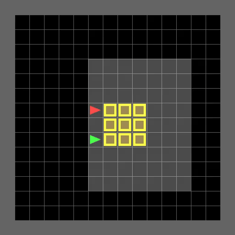

# MAIC-Research

## Tăng cường khả năng khám phá trong học tăng cường đa tác tử dựa trên Information Gain

### 1. Tổng quan

Dự án nghiên cứu khả năng khám phá trong học tăng cường đa tác tử hợp tác
(Cooperative Multi-Agent Reinforcement Learning – MARL), tập trung vào phương
pháp MAIC sử dụng Information Gain để định hướng quá trình khám phá môi trường.

Nghiên cứu bao gồm tái hiện kết quả MAIC, phân tích tính ổn định của
quá trình tối ưu chính sách, thử nghiệm Exact KL và đánh giá khả năng
mở rộng trên các môi trường có kích thước khác nhau.

### 2. Mục tiêu

- Tái hiện thực nghiệm MAIC và các thuật toán đối chứng.
- Phân tích vai trò của Information Gain trong khám phá.
- Kiểm tra ảnh hưởng của Exact KL đến quá trình học.
- Đánh giá tính ổn định của chính sách qua nhiều random seed.
- Kiểm chứng hiệu quả trên môi trường 16×16, 24×24 và 32×32.

### 3. Mã nguồn kế thừa

Dự án được phát triển trên cơ sở mã nguồn MAIC của Hoàng Văn Phi.

Repository gốc:
https://github.com/hoangvanphi2004/MAIC

Phiên bản mã gốc được ghi nhận trong:
docs/phi_source_commit.txt

Các mã nguồn kế thừa và những thành phần triển khai bổ sung được phân biệt
trong tài liệu nghiên cứu.

### 4. Thuật toán

| Thuật toán | Vai trò |
|---|---|
| MAIC | Phương pháp sử dụng Information Gain |
| MASAC | Đối chứng không sử dụng Information Gain |
| MADDPG | Thuật toán đối chứng |
| COMA-configured MAIC | Cấu hình IG=0 và entropy=0 theo mã Phi |
| MAIC + Exact KL | Biến thể nghiên cứu cơ chế KL |
| MASAC + Exact KL | Đối chứng cho biến thể Exact KL |

Lưu ý: COMA-configured MAIC không được đồng nhất với triển khai
COMA on-policy nguyên bản.

### 5. Môi trường thực nghiệm

- Multi-Target: khám phá và thu thập mục tiêu.
- PushBox: đẩy hộp trong môi trường hợp tác.
- PassSparse: phối hợp kích hoạt công tắc và di chuyển qua cửa.

Các kích thước nghiên cứu:

| Kích thước | Horizon |
|---|---:|
| 16×16 | 40 |
| 24×24 | 60 |
| 32×32 | 80 |

### 6. Thực nghiệm

#### 6.1. Tái hiện trên môi trường 16×16

Các thuật toán MAIC, MASAC và MADDPG được huấn luyện trên
10 random seed từ 42 đến 51.

Cấu hình COMA theo mã nguồn Phi cũng đã hoàn thành
30 run, mỗi run 5.000 episode.

Kết quả đánh giá COMA-configured MAIC:

| Môi trường | Greedy success | Stochastic success |
|---|---:|---:|
| Multi-Target | 0% | 0% |
| PushBox | 0% | 0% |
| PassSparse | 0% | 0% |

Các giá trị trên được tính từ 10 seed, mỗi seed được đánh giá
100 episode cho mỗi chế độ.

#### 6.2. Phân tích Exact KL

Thực nghiệm MAIC + Exact KL và MASAC + Exact KL
trên PushBox16 với 10 random seed.

Kết quả huấn luyện cho thấy 6/10 seed MAIC + Exact KL
có reward trung bình dương trong 500 episode cuối,
so với 1/10 seed của MASAC + Exact KL.

Đây là kết quả huấn luyện, không đồng nghĩa với tỷ lệ thành công
trên tập đánh giá độc lập.

<!-- EXACT_KL_FORMULA_START -->

#### 6.2.1. Cơ sở toán học và thay đổi Exact KL

**A. Cơ chế KL trong MAIC gốc**

Xét hệ thống gồm $n$ tác tử. Chính sách chung được phân tích thành:

$$
\pi_{\theta}(\mathbf{a}\mid\mathbf{o})
=
\prod_{i=1}^{n}
\pi_{\theta_i}(a_i\mid o_i).
$$

Trong mã MAIC gốc, hệ số surrogate được xây dựng từ log-probability
của hành động chung:

$$
\begin{aligned}
g_i^{\mathrm{gốc}}
={}&
(\alpha_1c_H+\lambda)
\left[\log\pi_{\theta}(\mathbf a\mid\mathbf o)+1\right]\\
&-\lambda\log\pi_{\mathrm{old}}(\mathbf a\mid\mathbf o)\\
&-\widehat A_i
-\alpha_2c_I\widehat I(\mathbf s,\mathbf a).
\end{aligned}
$$

Trong đó:

- $\alpha_1$: hệ số entropy.
- $\alpha_2$: hệ số Information Gain.
- $c_H,c_I$: các hệ số điều chỉnh tương ứng.
- $\lambda=\alpha_{KL}$: hệ số regularization.
- $\widehat A_i$: advantage của tác tử $i$.
- $\widehat I$: ước lượng Information Gain.

Hạng loss cho tác tử $i$ có dạng:

$$
\mathcal L_i^{\mathrm{gốc}}
=
\mathbb E_{\mathcal D}
\left[
\operatorname{sg}(g_i^{\mathrm{gốc}})
\log\pi_{\theta_i}(a_i\mid o_i)
\right],
$$

với $\operatorname{sg}$ là phép dừng gradient (`detach`).

Mã MAIC gốc đã tính giá trị KL chính xác để ghi nhận thống kê.
Tuy nhiên, hạng regularization trong Actor loss sử dụng
surrogate gradient thay vì lấy đạo hàm trực tiếp từ giá trị KL đó.

**B. Công thức Exact KL**

Đối với chính sách rời rạc, KL divergence được tính trên toàn bộ
không gian hành động:

$$
\boxed{
D_{\mathrm{KL}}
\left(
\pi_{\theta_i}\|
\pi_{\mathrm{old},i}
\right)
=
\sum_{a\in\mathcal A_i}
\pi_{\theta_i}(a\mid o_i)
\log
\frac{
\pi_{\theta_i}(a\mid o_i)
}{
\pi_{\mathrm{old},i}(a\mid o_i)
}
}
$$

Với minibatch $\mathcal B$, hạng regularization mới là:

$$
\mathcal L_{\mathrm{KL}}^{\mathrm{Exact}}
=
\lambda
\sum_{i=1}^{n}
\frac{1}{|\mathcal B|}
\sum_{o_i\in\mathcal B}
D_{\mathrm{KL}}
\left(
\pi_{\theta_i}(\cdot\mid o_i)
\|
\pi_{\mathrm{old},i}(\cdot\mid o_i)
\right).
$$

Chính sách cũ được lưu dưới dạng snapshot và tách khỏi đồ thị
gradient ở đầu bước cập nhật Actor.

**C. Hàm mất mát Actor sau điều chỉnh**

Loại bỏ hạng KL surrogate cũ, ta có hệ số:

$$
g_i^{\mathrm{base}}
=
\alpha_1 c_H
\left[
\log\pi_{\theta}(\mathbf a\mid\mathbf o)+1
\right]
-\widehat A_i
-\alpha_2c_I\widehat I.
$$

Hàm mất mát Actor của biến thể Exact KL:

$$
\boxed{
\begin{aligned}
\mathcal L_{\mathrm{Actor}}^{\mathrm{ExactKL}}
={}&
\sum_{i=1}^{n}
\mathbb E_{\mathcal B}
\left[
\operatorname{sg}(g_i^{\mathrm{base}})
\log\pi_{\theta_i}(a_i\mid o_i)
\right]\\
&+
\lambda
\sum_{i=1}^{n}
\mathbb E_{o_i\sim\mathcal B}
\left[
D_{\mathrm{KL}}
\left(
\pi_{\theta_i}\|
\pi_{\mathrm{old},i}
\right)
\right].
\end{aligned}
}
$$

**D. Bản chất thay đổi**

| Thành phần | MAIC gốc | MAIC + Exact KL |
|---|---|---|
| Information Gain | Giữ nguyên | Giữ nguyên |
| Counterfactual advantage | Có | Có |
| Actor | Chính sách phân tán | Không đổi kiến trúc |
| KL được ghi log | Exact KL | Exact KL |
| KL trong Actor loss | Surrogate | Exact KL trực tiếp |
| Gradient regularization | Qua surrogate | Qua tổng KL rời rạc |

Biến thể này không thay đổi công thức Information Gain hoặc kiến
trúc Actor–Critic. Thay đổi chính là cách hạng KL regularization
tham gia vào quá trình tối ưu chính sách.

**E. Kết quả bước đầu**

Trong thực nghiệm PushBox16 với 10 random seed:

- MAIC gốc: 0/10 seed có reward trung bình dương ở 500 episode cuối.
- MAIC + Exact KL: 6/10 seed.
- MASAC gốc: 0/10 seed.
- MASAC + Exact KL: 1/10 seed.

Các con số trên phản ánh kết quả huấn luyện, không phải tỷ lệ
thành công khi đánh giá checkpoint trên tập thử nghiệm.

<!-- EXACT_KL_FORMULA_END -->

#### 6.3. Mở rộng môi trường

Các môi trường 24×24 và 32×32 đã được kiểm tra
về khả năng khởi tạo và chạy thử.

Thực nghiệm huấn luyện mở rộng đang tiếp tục được cập nhật.

<!-- EXACT_KL_VIDEO_START -->

#### 6.4. Video minh họa MAIC + Exact KL giải thành công PushBox16

Video dưới đây minh họa quá trình tương tác của hai tác tử
trong môi trường PushBox16.

| Thông tin | Giá trị |
|---|---|
| Thuật toán | MAIC + Exact KL |
| Môi trường | PushBox16 (16×16) |
| Random seed | 51 |
| Checkpoint | Episode 2000 |
| Chế độ | Greedy |

*Video được tạo từ checkpoint trung gian episode 2000.
Đây là minh họa một lần thực hiện thành công, không đại diện
cho tỷ lệ thành công của checkpoint cuối cùng. Trên seed 51,
chính sách đã suy giảm ở các checkpoint muộn hơn.*

<!-- EXACT_KL_VIDEO_END -->

### 7. Cấu trúc mã nguồn

- third_party/MAIC/: mã nguồn MAIC kế thừa.
- baselines/: thuật toán đối chứng bổ sung.
- tools/: công cụ huấn luyện, đánh giá và thống kê.
- configs/: cấu hình thực nghiệm.
- patches/: những điều chỉnh mã nguồn.
- reports/: kết quả thực nghiệm.
- docs/: tài liệu nghiên cứu.

### 8. Hạn chế

Kết quả có thể nhạy với random seed, mất ổn định trong quá trình
huấn luyện và chưa chứng minh khả năng khái quát hóa trên mọi
cấu hình môi trường.

Việc tăng kích thước lưới không nhất thiết làm tăng độ phức tạp
phối hợp giữa các tác tử.

### 9. Ghi nhận

Dự án ghi nhận đóng góp của Hoàng Văn Phi đối với mã nguồn
MAIC ban đầu và các tác giả của những thuật toán liên quan.

Việc phân phối mã nguồn kế thừa phải tuân thủ quyền sử dụng
của tác giả gốc.
