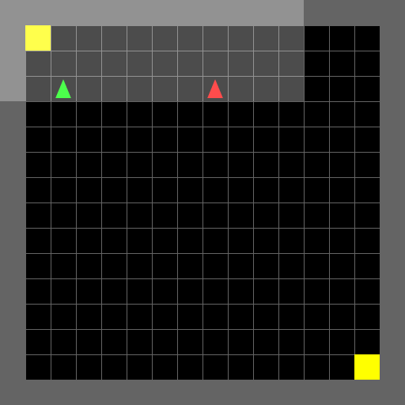
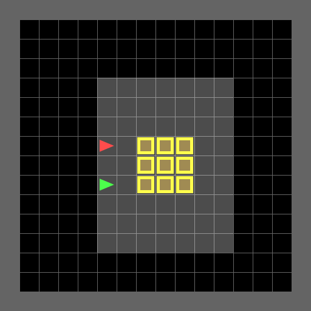
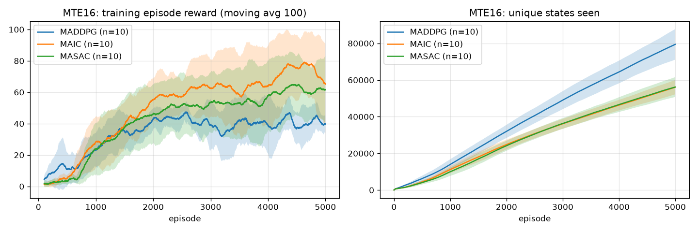
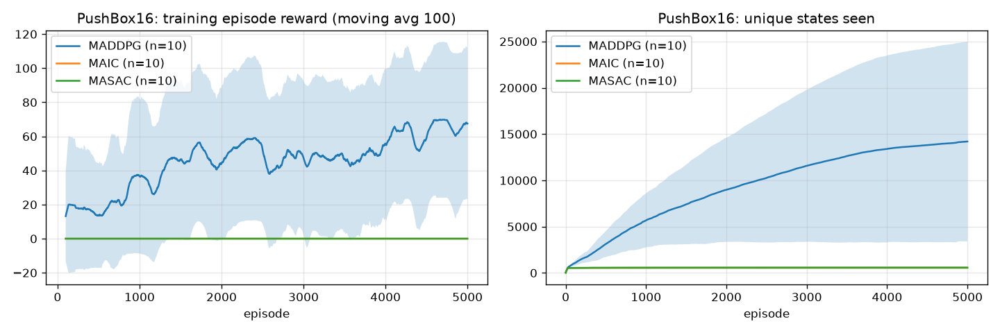
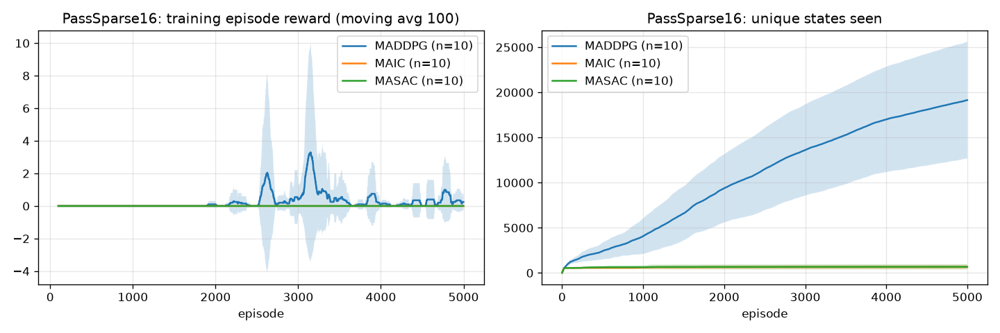
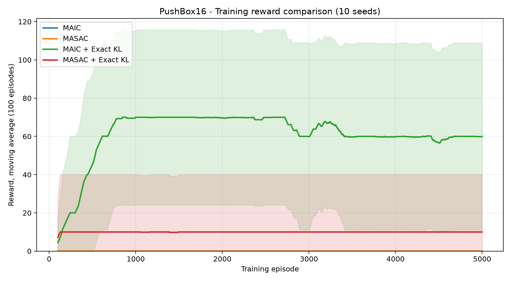
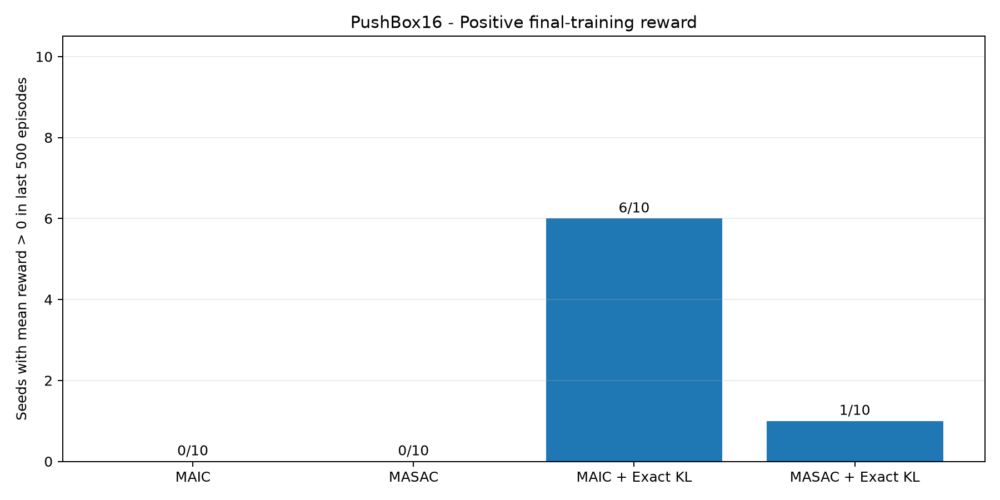

# MAIC-Research

## Tăng cường khả năng khám phá trong học tăng cường đa tác tử dựa trên Information Gain

### 1. Tổng quan

Dự án nghiên cứu khả năng khám phá trong học tăng cường đa tác tử hợp tác
(Cooperative Multi-Agent Reinforcement Learning – MARL), tập trung vào phương
pháp MAIC sử dụng Information Gain để định hướng quá trình khám phá môi trường.

Nghiên cứu bao gồm tái hiện kết quả MAIC, phân tích tính ổn định của
quá trình tối ưu chính sách, thử nghiệm Exact KL và đánh giá khả năng
mở rộng trên các môi trường có kích thước khác nhau.

### 2. Mục tiêu

- Tái hiện thực nghiệm MAIC và các thuật toán đối chứng.
- Phân tích vai trò của Information Gain trong khám phá.
- Kiểm tra ảnh hưởng của Exact KL đến quá trình học.
- Đánh giá tính ổn định của chính sách qua nhiều random seed.
- Kiểm chứng hiệu quả trên môi trường 16×16, 24×24 và 32×32.

### 3. Mã nguồn kế thừa

Dự án được phát triển trên cơ sở mã nguồn MAIC của Hoàng Văn Phi.

Repository gốc:
https://github.com/hoangvanphi2004/MAIC

Phiên bản mã gốc được ghi nhận trong:
docs/phi_source_commit.txt

Các mã nguồn kế thừa và những thành phần triển khai bổ sung được phân biệt
trong tài liệu nghiên cứu.

### 4. Thuật toán

| Thuật toán | Vai trò |
|---|---|
| MAIC | Phương pháp sử dụng Information Gain |
| MASAC | Đối chứng không sử dụng Information Gain |
| MADDPG | Thuật toán đối chứng |
| COMA-configured MAIC | Cấu hình IG=0 và entropy=0 theo mã Phi |
| MAIC + Exact KL | Biến thể nghiên cứu cơ chế KL |
| MASAC + Exact KL | Đối chứng cho biến thể Exact KL |

Lưu ý: COMA-configured MAIC không được đồng nhất với triển khai
COMA on-policy nguyên bản.

### 5. Môi trường thực nghiệm

- Multi-Target: khám phá và thu thập mục tiêu.
- PushBox: đẩy hộp trong môi trường hợp tác.
- PassSparse: phối hợp kích hoạt công tắc và di chuyển qua cửa.

Các kích thước nghiên cứu:

| Kích thước | Horizon |
|---|---:|
| 16×16 | 40 |
| 24×24 | 60 |
| 32×32 | 80 |

### 6. Thực nghiệm

#### 6.1. Tái hiện trên môi trường 16×16

Các thuật toán MAIC, MASAC và MADDPG được huấn luyện trên
10 random seed từ 42 đến 51.

Cấu hình COMA theo mã nguồn Phi cũng đã hoàn thành
30 run, mỗi run 5.000 episode.

Kết quả đánh giá COMA-configured MAIC:

| Môi trường | Greedy success | Stochastic success |
|---|---:|---:|
| Multi-Target | 0% | 0% |
| PushBox | 0% | 0% |
| PassSparse | 0% | 0% |

Các giá trị trên được tính từ 10 seed, mỗi seed được đánh giá
100 episode cho mỗi chế độ.

#### 6.2. Phân tích Exact KL

Thực nghiệm MAIC + Exact KL và MASAC + Exact KL
trên PushBox16 với 10 random seed.

Kết quả huấn luyện cho thấy 6/10 seed MAIC + Exact KL
có reward trung bình dương trong 500 episode cuối,
so với 1/10 seed của MASAC + Exact KL.

Đây là kết quả huấn luyện, không đồng nghĩa với tỷ lệ thành công
trên tập đánh giá độc lập.


<!-- EXACT_KL_FORMULA_START -->


#### 6.2.1. Cơ sở toán học của Exact KL

##### A. Chính sách đa tác tử

Với hệ thống gồm n tác tử, chính sách chung được phân tích thành:

```math
\pi_{\theta}(\mathbf{a}\mid\mathbf{o})
=
\prod_{i=1}^{n}\pi_{\theta_i}(a_i\mid o_i)
```

##### B. Cách tối ưu KL trong MAIC gốc

Trong mã MAIC gốc, hệ số cập nhật Actor được xây dựng theo:

```math
\begin{aligned}
g_i^{\mathrm{old}}
={}&
(\alpha_1 c_H+\lambda)
(\log\pi_{\theta}(\mathbf a\mid\mathbf o)+1)\\
&-\lambda\log\pi_{\mathrm{old}}(\mathbf a\mid\mathbf o)\\
&-\widehat A_i-\alpha_2c_I\widehat I
\end{aligned}
```

Trong đó:

- `alpha1`: hệ số entropy.
- `alpha2`: hệ số Information Gain.
- `lambda = alpha_kl`: hệ số KL regularization.
- `A_i`: counterfactual advantage của tác tử i.
- `I`: ước lượng Information Gain.
- `c_H`, `c_I`: hệ số kích hoạt các thành phần tương ứng.

Hàm mất mát Actor sử dụng hệ số đã dừng gradient:

```math
\mathcal L_i^{\mathrm{old}}
=
\mathbb E_{\mathcal B}
\left[
\mathrm{sg}(g_i^{\mathrm{old}})
\log\pi_{\theta_i}(a_i\mid o_i)
\right]
```

Ký hiệu `sg` biểu diễn thao tác `detach()`.

Mã MAIC gốc đã tính Exact KL để ghi log. Tuy nhiên,
hạng regularization trong Actor loss được triển khai
thông qua surrogate, không lấy gradient trực tiếp từ
giá trị Exact KL được ghi nhận.

##### C. Công thức Exact KL

Đối với chính sách hành động rời rạc:

```math
D_{\mathrm{KL}}
(\pi_{\theta_i}\|\pi_{\mathrm{old},i})
=
\sum_{a\in\mathcal A_i}
\pi_{\theta_i}(a\mid o_i)
\log
\frac{\pi_{\theta_i}(a\mid o_i)}
{\pi_{\mathrm{old},i}(a\mid o_i)}
```

Khác với cách chỉ sử dụng hành động có trong minibatch,
công thức trên tính tổng theo toàn bộ không gian
hành động rời rạc của mỗi tác tử.

##### D. Hàm mất mát Actor mới

Sau khi loại bỏ hạng KL surrogate cũ:

```math
g_i^{\mathrm{base}}
=
\alpha_1 c_H
(\log\pi_{\theta}(\mathbf a\mid\mathbf o)+1)
-\widehat A_i-\alpha_2c_I\widehat I
```

Hàm mất mát Actor của biến thể Exact KL:

```math
\begin{aligned}
\mathcal L_{\mathrm{Actor}}^{\mathrm{ExactKL}}
={}&
\sum_{i=1}^{n}
\mathbb E_{\mathcal B}
\left[
\mathrm{sg}(g_i^{\mathrm{base}})
\log\pi_{\theta_i}(a_i\mid o_i)
\right]\\
&+
\lambda\sum_{i=1}^{n}
\mathbb E_{\mathcal B}
\left[
D_{\mathrm{KL}}
(\pi_{\theta_i}\|\pi_{\mathrm{old},i})
\right]
\end{aligned}
```

Chính sách cũ được lưu dưới dạng snapshot không nhận gradient.
Hạng Exact KL được cộng trực tiếp vào `total_policy_loss`
trước khi thực hiện `backward()`.

##### E. So sánh trước và sau thay đổi

| Thành phần | MAIC gốc | MAIC + Exact KL |
|---|---|---|
| Information Gain | Không đổi | Không đổi |
| Counterfactual advantage | Có | Có |
| Kiến trúc Actor–Critic | MAIC | MAIC |
| Giá trị KL để ghi log | Exact KL | Exact KL |
| KL trong Actor loss | Surrogate | Exact KL trực tiếp |
| Gradient KL | Thông qua surrogate | Đạo hàm hạng KL đầy đủ |

**Bản chất cải tiến:** thay đổi cách regularization KL
tham gia vào tối ưu chính sách, không thay đổi công thức
Information Gain hoặc kiến trúc MAIC.

#### 6.3. Mở rộng môi trường

Các môi trường 24×24 và 32×32 đã được kiểm tra
về khả năng khởi tạo và chạy thử.

Thực nghiệm huấn luyện mở rộng đang tiếp tục được cập nhật.


<!-- EXACT_KL_VIDEO_START -->

#### 6.4. GIF minh họa kết quả mô hình

Hai GIF dưới đây được tạo từ checkpoint của các
chính sách đã huấn luyện và có episode hoàn thành nhiệm vụ.

##### 6.4.1. Multi-Target 16×16 — MAIC gốc

- Thuật toán: MAIC gốc.
- Seed huấn luyện: 42.
- Chính sách: Stochastic.
- Minh họa một episode hoàn thành nhiệm vụ.



##### 6.4.2. PushBox 16×16 — MAIC + Exact KL

- Thuật toán: MAIC + Exact KL.
- Seed huấn luyện: 51.
- Checkpoint: Episode 2000.
- Chính sách: Greedy.



Tỷ lệ hoàn thành tại checkpoint episode 2000: **100% (100 episode đánh giá)**. Hiệu năng suy giảm tại các checkpoint episode 3000–5000.


#### 6.5. Biểu đồ thực nghiệm trên ba môi trường

Các hình dưới đây được tổng hợp từ thực nghiệm
MAIC, MASAC và MADDPG trên 10 seed (42–51).

##### 6.5.1. Multi-Target 16×16

Biểu đồ phần thưởng huấn luyện và số trạng thái
được khám phá.



##### 6.5.2. PushBox 16×16

Biểu đồ so sánh quá trình huấn luyện của
các thuật toán đối chứng.



##### 6.5.3. PassSparse 16×16

Biểu đồ thể hiện kết quả khám phá và phần thưởng
trên nhiệm vụ phối hợp mở cửa.

Không có GIF thành công của chính sách MAIC trên
PassSparse16 được công bố trong mục này.



#### 6.6. Phân tích tác động của Exact KL

##### 6.6.1. Đường học trên PushBox16

So sánh MAIC, MASAC, MAIC + Exact KL và
MASAC + Exact KL.

Các đường biểu diễn trung bình qua 10 seed,
với trung bình trượt 100 episode và dải
biến thiên một độ lệch chuẩn.



##### 6.6.2. Số seed duy trì reward dương

Số seed có reward trung bình lớn hơn 0
trong 500 episode huấn luyện cuối cùng.




### 7. Cấu trúc mã nguồn

- third_party/MAIC/: mã nguồn MAIC kế thừa.
- baselines/: thuật toán đối chứng bổ sung.
- tools/: công cụ huấn luyện, đánh giá và thống kê.
- configs/: cấu hình thực nghiệm.
- patches/: những điều chỉnh mã nguồn.
- reports/: kết quả thực nghiệm.
- docs/: tài liệu nghiên cứu.

### 8. Hạn chế

Kết quả có thể nhạy với random seed, mất ổn định trong quá trình
huấn luyện và chưa chứng minh khả năng khái quát hóa trên mọi
cấu hình môi trường.

Việc tăng kích thước lưới không nhất thiết làm tăng độ phức tạp
phối hợp giữa các tác tử.

### 9. Ghi nhận

Dự án ghi nhận đóng góp của Hoàng Văn Phi đối với mã nguồn
MAIC ban đầu và các tác giả của những thuật toán liên quan.

Việc phân phối mã nguồn kế thừa phải tuân thủ quyền sử dụng
của tác giả gốc.
