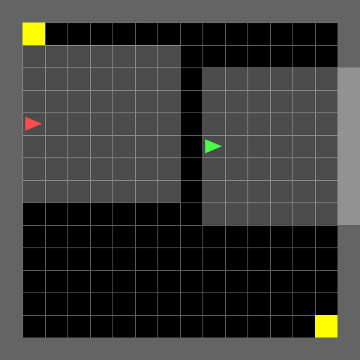
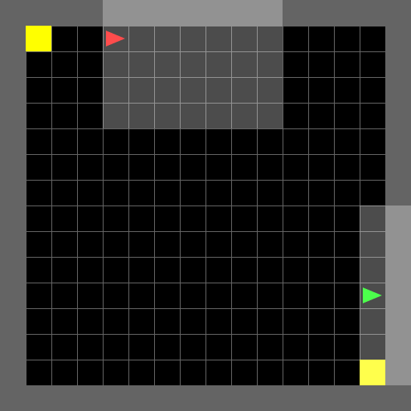
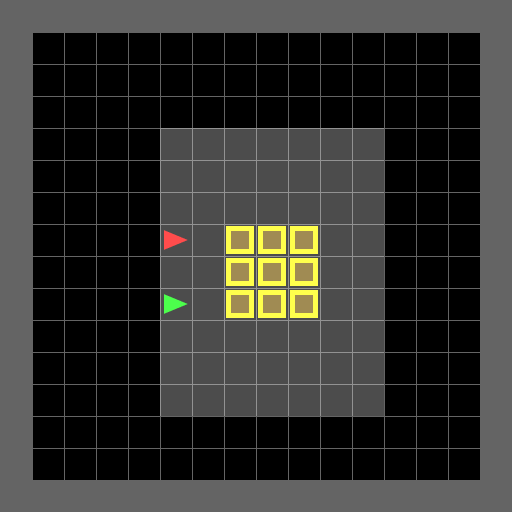
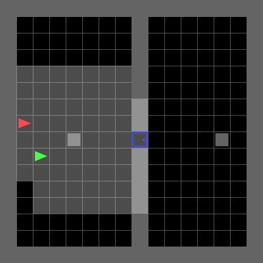

# Danh mục hình nghiên cứu và video mô phỏng chính sách

Các hình trong thư mục [`assets/study16/figures`](../../assets/study16/figures) sử dụng cùng bảng 90 run và quy tắc màu phân biệt thuật toán. Các seed được hiển thị bằng điểm dữ liệu, không gán màu cho từng seed. Bản PNG phục vụ xem nhanh và PDF vector phục vụ bài báo.

## 1. Các hình trọng tâm

| Hình | Mục đích |
|:--|:--|
| [MTE16 theo chế độ đánh giá](../../assets/study16/figures/MTE16_success_greedy_stochastic.png) | Tỷ lệ hoàn thành nhiệm vụ của sáu cấu hình ở greedy/stochastic |
| [MTE16 so sánh ghép cặp theo seed](../../assets/study16/figures/MTE16_paired_seed_response.png) | So sánh MAIC/MASAC với biến thể Exact KL trên cùng seed |
| [PushBox16 theo seed](../../assets/study16/figures/PushBox16_success_per_seed.png) | Làm rõ 0/5 và 3/5 seed thành công |
| [Reward cuối huấn luyện PushBox16](../../assets/study16/figures/PushBox16_train_reward_last10pct.png) | Đối chiếu tác động quan sát trong huấn luyện và đánh giá |
| [PassSparse16 về trạng thái ghi nhận](../../assets/study16/figures/PassSparse16_unique_states_final.png) | Phân biệt độ đa dạng trạng thái với thành công nhiệm vụ |
| [Đường học MTE16](../../assets/study16/figures/curves_MTE16.png) | Quan sát tiến trình reward/trạng thái theo episode |
| [Đường học PushBox16](../../assets/study16/figures/curves_PushBox16.png) | Kiểm tra biến động huấn luyện giữa thuật toán |
| [Đường học PassSparse16](../../assets/study16/figures/curves_PassSparse16.png) | Diễn biến khám phá trên nhiệm vụ chưa giải được |

Các hình checkpoint trung gian khác ở cùng thư mục chỉ được sử dụng khi JSON đánh giá checkpoint có sẵn. Chúng không thay thế thống kê trên checkpoint cuối.

## 2. Video chính sách đã học

Các video dưới đây là rollout **từ checkpoint cuối** của Study16, không phải quỹ đạo điều khiển lập trình sẵn. Mỗi video chỉ mô phỏng **một episode** và đi kèm JSON có checkpoint, training seed, evaluation seed, chế độ lựa chọn hành động và trạng thái thành công.

### MTE16 — MAIC, stochastic, thành công

[MP4](../../assets/study16/demos/MTE16_MAIC_trainseed44_stochastic_evalseed20261_SUCCESS.mp4) · [JSON](../../assets/study16/demos/MTE16_MAIC_trainseed44_stochastic_evalseed20261_SUCCESS.json)

### MTE16 — MASAC + Exact KL, stochastic, thành công

[MP4](../../assets/study16/demos/MTE16_MASAC_ExactKL_trainseed42_stochastic_evalseed20261_SUCCESS.mp4) · [JSON](../../assets/study16/demos/MTE16_MASAC_ExactKL_trainseed42_stochastic_evalseed20261_SUCCESS.json)

### PushBox16 — MAIC + Exact KL, greedy, thành công

[MP4](../../assets/study16/demos/PushBox16_MAIC_ExactKL_trainseed46_greedy_evalseed20261_SUCCESS.mp4) · [JSON](../../assets/study16/demos/PushBox16_MAIC_ExactKL_trainseed46_greedy_evalseed20261_SUCCESS.json)

### PushBox16 — MADDPG, greedy, thành công

[MP4](../../assets/study16/demos/PushBox16_MADDPG_trainseed45_greedy_evalseed20261_SUCCESS.mp4) · [JSON](../../assets/study16/demos/PushBox16_MADDPG_trainseed45_greedy_evalseed20261_SUCCESS.json)

### PassSparse16 — MAIC + Exact KL, greedy, thất bại

[MP4](../../assets/study16/demos/PassSparse16_MAIC_ExactKL_trainseed42_greedy_evalseed20261_FAILURE.mp4) · [JSON](../../assets/study16/demos/PassSparse16_MAIC_ExactKL_trainseed42_greedy_evalseed20261_FAILURE.json)

**Lưu ý đánh giá:** Video thành công được chọn có chủ đích chỉ để minh họa hành vi của chính sách đã học. Không sử dụng tỷ lệ video thành công trong danh mục này để ước lượng success rate. Tỷ lệ trung bình được tính từ 100 episode đánh giá theo từng seed và từng chế độ. Một video thất bại trên PassSparse16 không phải bằng chứng duy nhất của kết quả thất bại; kết luận dựa trên 90 bảng dữ liệu cuối kỳ.
