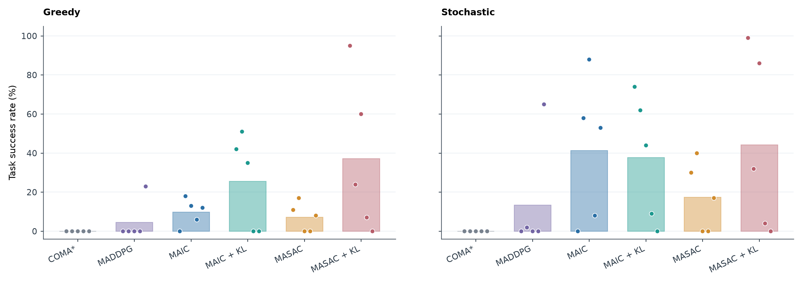
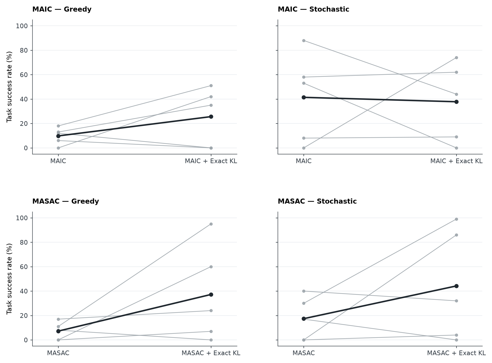
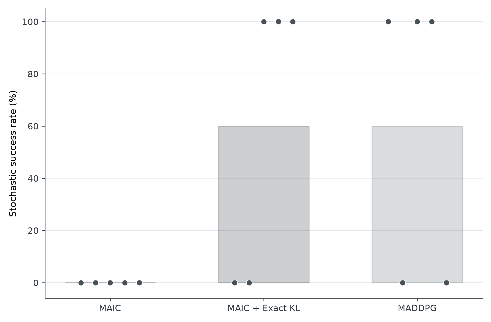
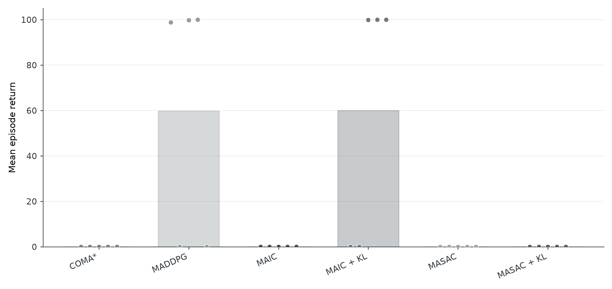
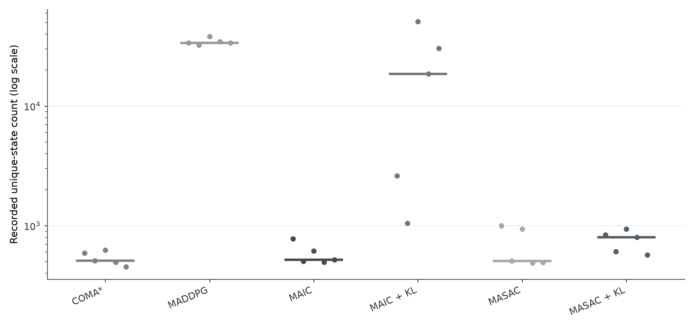
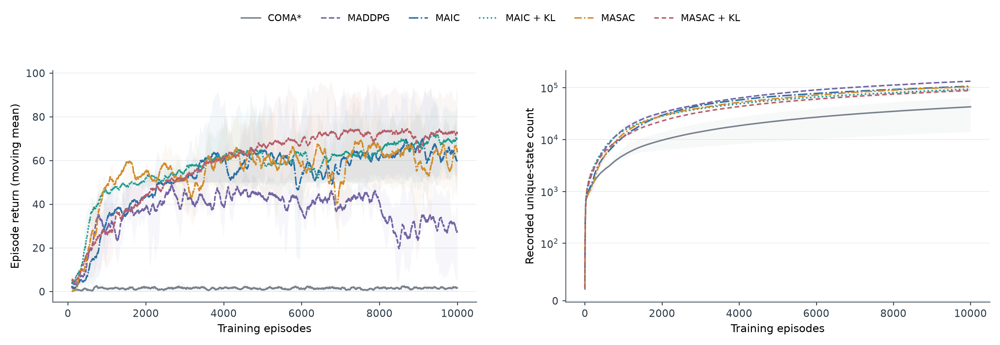
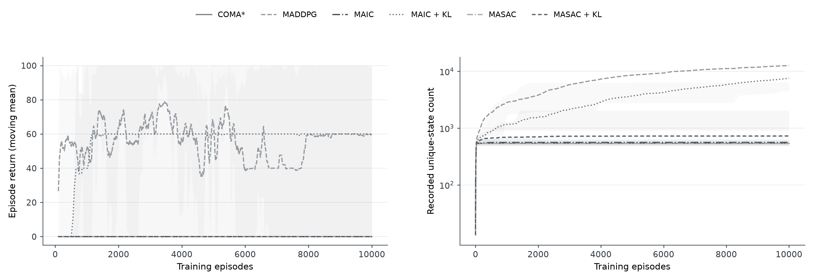
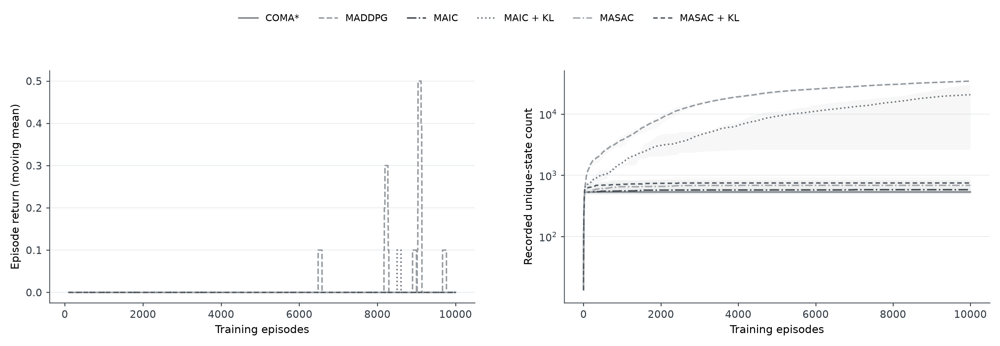

# Phân tích thực nghiệm theo seed và độ ổn định của Study16

## Phạm vi dữ liệu

Ba môi trường MTE16, PushBox16 và PassSparse16; sáu cấu hình; năm seed huấn luyện 42–46; 10.000 episode/run; horizon 40. Mỗi checkpoint cuối được đánh giá với 100 episode cho mỗi chế độ greedy và stochastic. Số liệu ở đây được lấy từ [bảng 90 run](../../results/study16/per_seed_values.csv), không gộp với thực nghiệm 5.000 episode trước đây.

## 1. Hiệu quả trên Multi-Target 16×16

| So sánh | Greedy success trước | Greedy success sau | Stochastic trước | Stochastic sau |
|:--|--:|--:|--:|--:|
| MAIC → MAIC + Exact KL | 9,8% | 25,6% | 41,4% | 37,8% |
| MASAC → MASAC + Exact KL | 7,2% | 37,2% | 17,4% | 44,2% |

Chênh lệch trung bình MAIC là +15,8 điểm phần trăm ở greedy nhưng −3,6 ở stochastic. Đối với MASAC, chênh lệch lần lượt +30,0 và +26,8 điểm phần trăm. Tính không đồng nhất giữa các chế độ đánh giá phản ánh thay đổi phân phối hành động chứ không chứng minh hiệu quả tổng quát của Exact KL.

## 2. Hiệu quả trên PushBox16

Tỷ lệ hoàn thành nhiệm vụ ở checkpoint cuối, tính trên 100 episode/seed, cho hai chế độ đánh giá đều nhận các giá trị dưới đây.

| Seed | MAIC | MAIC + Exact KL | MADDPG |
|--:|--:|--:|--:|
| 42 | 0% | 0% | 100% |
| 43 | 0% | 0% | 0% |
| 44 | 0% | 100% | 100% |
| 45 | 0% | 100% | 100% |
| 46 | 0% | 100% | 0% |
| Trung bình | 0% | 60% | 60% |

MAIC gốc không giải được nhiệm vụ ở cả năm seed, còn MAIC + Exact KL thành công ở ba seed. MADDPG cũng có ba seed thành công, nhưng phân bố khác nhau giữa seed 42 và 46. Với chỉ năm seed, kiểm định hoán đổi dấu hai phía theo cặp MAIC–MAIC + Exact KL có $p=0{,}25$; chưa có bằng chứng về ưu thế có ý nghĩa thống kê ở ngưỡng 5%.

## 3. Giới hạn trên PassSparse16

Cả sáu cấu hình đều có tỷ lệ hoàn thành nhiệm vụ 0% trong đánh giá checkpoint cuối. Số trạng thái duy nhất được ghi nhận ở MAIC là 581,8 ± 105,9; ở MAIC + Exact KL là 20.669 ± 18.515,6; ở MADDPG là 34.505,8 ± 1.977,7. Không nên hiểu `unique_states_final` như phép đo trực tiếp của khả năng phối hợp hoặc độ bao phủ trạng thái hữu ích nếu chưa kiểm tra mã hóa trạng thái và cơ chế ghi log.

## 4. Đường học và checkpoint trung gian

Các hình đường học phải lấy từ `metrics_latest.json` của từng run; các hình ổn định checkpoint phải dựa trên JSON đánh giá checkpoint tương ứng, không nội suy hoặc ghép số liệu từ thực nghiệm thăm dò trước.

Sự biến động giữa các seed cần được trình bày bằng dữ liệu ghép cặp. Không xem 500 episode đánh giá của một cấu hình là 500 lần lặp huấn luyện độc lập.

## 5. Giới hạn suy luận

- Năm seed chưa đủ để khẳng định ưu thế ổn định hoặc ý nghĩa thống kê ở nhiều môi trường.
- Exact KL không cải thiện đồng thời greedy và stochastic trong mọi cấu hình.
- Trong PushBox16, 60% là trung bình qua năm seed; không phải xác suất thành công 60% của từng chính sách.
- PassSparse16 ghi nhận hiện tượng khám phá mà không hoàn thành nhiệm vụ; cần kiểm chứng điều kiện kết thúc và giới hạn horizon 40 trước khi suy luận cơ chế.
- Các video lựa chọn một episode thành công hoặc thất bại không thay thế kết quả đánh giá theo seed.

Xem [tài liệu tái lập](REPRODUCIBILITY.md), [bộ hình và video](FIGURES_AND_DEMOS.md) và [trạng thái lưu trữ](LUU_TRU_DU_LIEU.md).
